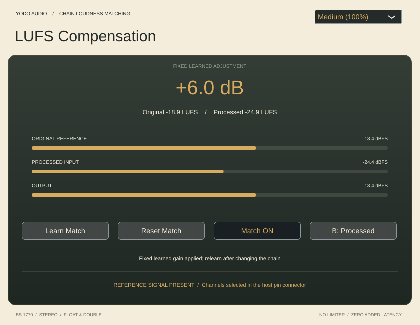
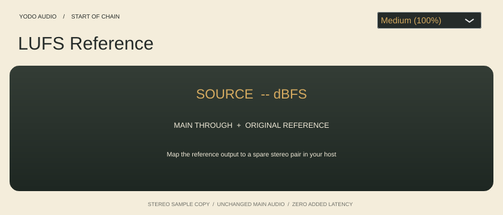

# LUFS Compensation

Two stereo **VST3 plugins for Apple Silicon**, built together with JUCE in the same style as
[ToTape Studio](https://github.com/johandoornenbal/tape),
[Wider Studio](https://github.com/johandoornenbal/wide), and ButterComp Studio.
Compare an entire effect chain at matched loudness, using its original signal
as a sidechain reference. Neither plugin contains Airwindows DSP.



Put **LUFS Reference.vst3** first in a REAPER track's FX chain, and
**LUFS Compensation.vst3** last. Reference passes the main audio unchanged and
copies it to an auxiliary stereo output. Compensation measures the original and processed signals,
then applies a fixed learned gain to the processed path. It never changes the
plugins between them.

**All channel assignments are configurable in REAPER's pin connectors.** The
convenient default is processed audio on track channels 1/2 and original reference
on 3/4. Reference's auxiliary outputs can instead go to 5/6 or another pair;
map the VST's Original reference input to the same pair. Its main input and output
can also be mapped independently. The plugin uses named stereo buses rather than
assuming global track channel numbers. See [REAPER setup](docs/REAPER.md).



**LUFS Reference** exposes one stereo Source input and two stereo outputs:
Main through and Original reference. It copies samples exactly in float and double,
adds no delay or gain, and has a source-level indicator. Its interface also offers
75%, 100%, and 125% sizes with session recall. If its reference output bus is
disabled, main audio still passes unchanged. Host bypass clears the reference
output while preserving main audio; keep Reference active for learning and A/B.

## Compensation controls

- **Learn Match** starts stereo BS.1770 K-weighted, absolute/relative-gated LUFS
  measurement. Start playback first and choose a representative section. The clock
  pauses on silent reference windows and completes after 15 seconds of accepted
  audio (at least 15.3 seconds of continuous playback including window warm-up).
- **Finish Learning** accepts at least 3 seconds of accepted reference audio.
  Insufficient audio or unmeasurable processed output preserves the previous match.
- The signed adjustment is **original LUFS minus processed LUFS**. It remains
  fixed until you learn again or reset. It does not continually turn down dynamic
  passages. Changing the chain's settings requires learning again.
- **Match ON/OFF** disables the learned gain without losing it.
- **A: Original / B: Processed** listens to either the reference or the processed
  chain. Match applies only to the processed path. Switching uses a 5 ms fade;
  gain changes use a 20 ms ramp. Use these controls for loudness comparisons;
  REAPER's host bypass passes the uncompensated processed input through.
- **Reset Match** clears the adjustment without changing the A/B and Match switches.
- **Small (75%) / Medium (100%) / Large (125%)** scale the entire editor.

Learned gain, measured LUFS, switches, and interface size are recalled per instance
with the session. In-progress learning is not resumed after recall. Match and A/B
are automatable; the UI size and learned value are session state.

The meters show smoothed sample-peak levels in dBFS, with a 120 ms rise and
450 ms fall. Peaks between UI redraws are retained, and displays decay to rest
when audio callbacks stop. Display smoothing does not change audio or LUFS analysis. Gain is bounded to ±24 dB; a warning appears
when a required adjustment exceeds that range or the output exceeds 0 dBFS.
**This is not a limiter or a true-peak meter.** No fixed latency is added or
reported. Reference and processed paths should represent the same passage; chain
latency, misrouting, or source changes can spoil a measurement or A/B comparison.
The plugin does not measure or automatically align an upstream chain's latency.

A silent reference pauses learning and is flagged in the UI. A disabled sidechain
prevents learning and makes Original fall back to the processed path. An enabled
but silent sidechain is actual silence when listening to Original, so verify the
reference signal indicator before switching. Once learned, fixed gain can still
be used without the reference, but A/B and relearning need it.

## Build on Apple Silicon

Install Xcode Command Line Tools and CMake 3.22+, then:

```sh
cmake -S . -B build-mac -DCMAKE_BUILD_TYPE=Release \
  -DCMAKE_OSX_ARCHITECTURES=arm64 -DCMAKE_OSX_DEPLOYMENT_TARGET=11.0
cmake --build build-mac --config Release --parallel 3
ctest --test-dir build-mac -C Release --output-on-failure
```

JUCE 8.0.12 is pinned to commit `29396c22c93392d6738e021b83196283d6e4d850`.
To reuse an existing checkout, pass `-DJUCE_PATH=/absolute/path/to/JUCE`.
The same build produces both:

- `build-mac/LUFSReference_artefacts/Release/VST3/LUFS Reference.vst3`
- `build-mac/LUFSCompensation_artefacts/Release/VST3/LUFS Compensation.vst3`

```sh
codesign --force --deep --sign - "build-mac/LUFSReference_artefacts/Release/VST3/LUFS Reference.vst3"
codesign --force --deep --sign - "build-mac/LUFSCompensation_artefacts/Release/VST3/LUFS Compensation.vst3"
mkdir -p "$HOME/Library/Audio/Plug-Ins/VST3"
ditto "build-mac/LUFSReference_artefacts/Release/VST3/LUFS Reference.vst3" \
  "$HOME/Library/Audio/Plug-Ins/VST3/LUFS Reference.vst3"
ditto "build-mac/LUFSCompensation_artefacts/Release/VST3/LUFS Compensation.vst3" \
  "$HOME/Library/Audio/Plug-Ins/VST3/LUFS Compensation.vst3"
```

Rescan VST3 plugins in REAPER. GitHub Actions builds, tests, ad-hoc signs, and
archives both arm64 VST3 plugins together with the REAPER guide.
The macOS target matches the reference repositories. macOS compilation, signing,
and actual REAPER routing/playback require verification on macOS; the Linux
checks do not establish that those steps work. There is no AU target.

## Linux development and validation

The documented rootless setup, adapted from the reference projects, is:

```sh
bash scripts/setup-cloud.sh
source scripts/cloud-env.sh
```

It installs build tools and verified Debian development packages outside the
checkout and obtains pinned JUCE. With dependencies prepared:

```sh
cmake -S . -B build -DJUCE_PATH=/workspace/deps/JUCE -DCMAKE_BUILD_TYPE=Release
cmake --build build --parallel 3
ctest --test-dir build --output-on-failure
```

Independent LUFS and display-smoothing tests need no JUCE:

```sh
cmake -S . -B build-dsp -DLUFS_DSP_ONLY=ON -DCMAKE_BUILD_TYPE=Release
cmake --build build-dsp --parallel 2
ctest --test-dir build-dsp --output-on-failure
```

The loudness suite compares measurements against independent libebur128 at four
sample rates and checks gating, known gain, silence, short measurement, muted
output, and the gain cap. Plugin checks exercise stereo sidechain buffers,
bit-transparent unlearned float/double processing, compensated gain and recall,
fixed gain after programme changes, relearning, A/B, host bypass, missing reference,
state bounds, all three UI sizes, and real editor renders. Reference checks verify
exact sample copies at four rates, disabled output/bypass, and UI state. The chain
test runs the actual Reference processor into Compensation with a simulated 2×
effect and host channel mappings for 3/4 and 5/6, in float and double. Actual
REAPER playback remains a separate host validation.

## Licenses

Both plugin wrappers, UIs, meter ballistics, and LUFS matcher: MIT. LUFS filter design and the independent
test oracle derive from libebur128 (MIT and embedded BSD notices). JUCE has its
own AGPLv3/commercial terms. See [THIRD_PARTY.md](THIRD_PARTY.md).
